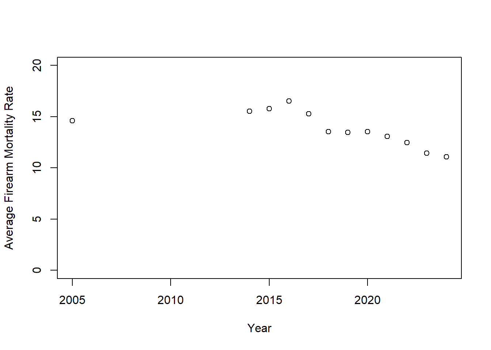
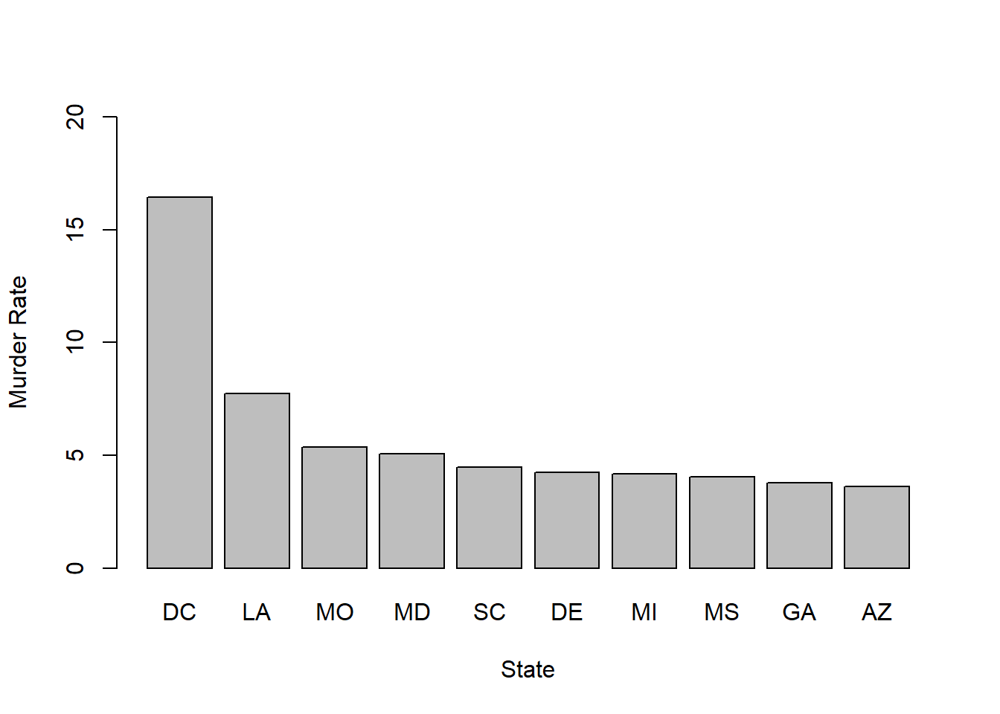
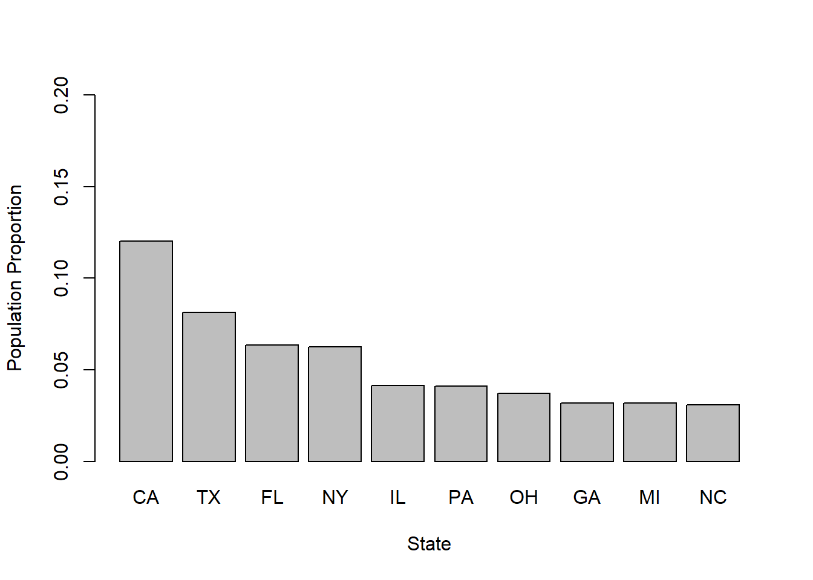

# BST260 Final Project Proposal

## Introduction

The datasets analyzed in this project include CDC Firearm Mortality,
RAND Gun Legislation, and CDC Homicide Mortality. The research
investigates whether the firearm mortality rate (death counts per
100,000 total population, adjusted for population size and age
distribution of each state) in the United States from 2014 to 2022 is
impacted by the number of restrictive and permissive legislative
changes. The three datasets provide information on the population within
50 states and special district of the United States.\
A permissive legislative change is defined as a new law that makes
accessing or using firearms easier compared to the status quo. A
restrictive legislative change is a new law that renders accessing or
using firearms more difficult compared to the status quo. The dataset
gives an effect label (“Permissive” or “Restrictive”) to each LawID (a
unique code for each law in the dataset), and no LawID misses an effect
label. This allows us to obtain the number of permissive and restrictive
laws in each year, which are non-negative integers.\
The continuous, numeric outcome variable is the average firearm
mortality rate in the United States each year. Given that the rates were
adjusted for population size of each state, it makes sense to calculate
the overall rate in the U.S. for each year by averaging the state rates.
We can also first solve for population size of each state by dividing
the number of deaths by the death rate. Then, we can use the total
number of deaths in a given year divided by the total population size
that year to obtain the overall death date. Since there is missing data
before 2014, and considering the timeliness of the data, the analysis is
restricted to 2014 to 2022. The years are unique, integer values.\
Based on the murders dataset, Michigan and Georgia are in the top 10
lists for both murder rate (murder counts per 100,000 population) and
state population as a proportion of the total U.S. population.
Therefore, the two states can have a large impact on the overall murder
rate of the U.S. Given that many murders are committed using firearms,
the project plans to take a closer look at the potential association
between the number of permissive and restrictive legislative changes,
firearm mortality rates, and murder rates in these two states. For
comparison purpose, the murder rate is also a continuous, floating point
variable. States are coded as factors for graphing in R.\
Potential confounders that may associate with both firearm (murder)
mortality rate and the number of gun legislative changes include firearm
ownership, economic condition, demographic characteristics (for example,
proportions of biological sex at birth), and political climate.

## CDC Firearm Mortality

``` r

# CDC Firearm Mortality
# Read and view the data
data(cdcfiremort, package = "finalproject")
cdcmort <- cdcfiremort
#View(cdcmort)
str(cdcmort)
```

    'data.frame':   612 obs. of  5 variables:
     $ YEAR      : int  2024 2024 2024 2024 2024 2024 2024 2024 2024 2024 ...
     $ Location  : chr  "Alabama" "Alaska" "Arizona" "Arkansas" ...
     $ Death.Rate: num  23.7 24.4 16.9 20.6 7 15.3 5.8 11.8 19.7 12.7 ...
     $ Deaths.   : int  1212 182 1331 638 2853 961 224 123 148 3191 ...
     $ URL       : chr  "/nchs/state-stats/states/al.html" "/nchs/state-stats/states/ak.html" "/nchs/state-stats/states/az.html" "/nchs/state-stats/states/ar.html" ...

``` r

library(ggplot2)
```

    Warning: package 'ggplot2' was built under R version 4.6.2

``` r

library(dplyr)
```

    Attaching package: 'dplyr'

    The following objects are masked from 'package:stats':

        filter, lag

    The following objects are masked from 'package:base':

        intersect, setdiff, setequal, union

``` r

meanmort <- cdcmort |> group_by(YEAR) |> summarise(mean(Death.Rate))
meanmort
```

    # A tibble: 12 × 2
        YEAR `mean(Death.Rate)`
       <int>              <dbl>
     1  2005               11.1
     2  2014               11.4
     3  2015               12.5
     4  2016               13.1
     5  2017               13.5
     6  2018               13.5
     7  2019               13.5
     8  2020               15.3
     9  2021               16.5
    10  2022               15.8
    11  2023               15.5
    12  2024               14.6

``` r

plot(unique(cdcmort$YEAR), meanmort[[2]], ylim=c(0,20), xlab="Year", ylab="Average Firearm Mortality Rate")
```



## RAND Gun Legislation

``` r

# data acquisition
data(gunleg, package = "finalproject")
lawdat <- gunleg
nd = lawdat
```

``` r

# `effdate` is a column with date values
library(lubridate)
```

    Attaching package: 'lubridate'

    The following objects are masked from 'package:base':

        date, intersect, setdiff, union

``` r

nd = nd |> mutate(effdate=ymd(paste(Effective.Date.Year, Effective.Date.Month, Effective.Date.Day, sep="-")))
```

``` r

#View(nd)
str(nd)
```

    'data.frame':   1902 obs. of  24 variables:
     $ Law.ID                                   : chr  "AK1002" "AK1003" "AK1004" "AK1005" ...
     $ State                                    : chr  "Alaska" "Alaska" "Alaska" "Alaska" ...
     $ State.Postal.Abbreviation                : chr  "AK" "AK" "AK" "AK" ...
     $ FIPS.Code                                : int  2 2 2 2 2 2 2 2 2 2 ...
     $ Law.Class..num.                          : int  2 2 2 3 3 7 7 7 7 10 ...
     $ Law.Class                                : chr  "carrying a concealed weapon (ccw)" "carrying a concealed weapon (ccw)" "carrying a concealed weapon (ccw)" "castle doctrine" ...
     $ Law.Class.Subtype                        : chr  "prohibited" "shall issue" "shall issue (permit not required)" "traditional" ...
     $ Handguns.or.Long.Guns                    : chr  "handgun" "handgun" "handgun" "handgun and long gun" ...
     $ Effect                                   : chr  "Restrictive" "Permissive" "Permissive" "Permissive" ...
     $ Type.of.Change                           : chr  "Implement" "Modify" "Modify" "Modify" ...
     $ Effective.Date.Note                      : chr  "See additional notes and comments about this date" "" "" "Not sure about day + month, so using January 1." ...
     $ Effective.Date.Year                      : int  1978 1994 2003 1978 2006 1980 1992 1980 1992 1996 ...
     $ Effective.Date.Month                     : int  1 10 9 1 9 1 9 1 9 7 ...
     $ Effective.Date.Day                       : int  1 1 9 1 13 1 14 1 14 1 ...
     $ Statutory.Citation                       : chr  "Alaska Stat. § 11.55.010" "Alaska Stat. § 18.65.700 et seq." "Permit-less CCW allowed through change to Alaska Stat. § 11.61.220; Permit rules described in Alaska Stat. § 18.65.700 et seq." "Alaska Stat. § 11.81.335" ...
     $ Content                                  : chr  "It is unlawful for a person to carry concealed about his person, in any manner, [enumerated weapons]." "Sec. 18.65.700. Permit to carry a concealed handgun.\n(a) The department shall issue a permit to carry a concea"| __truncated__ "§ 11.61.220(a) A person commits the crime of misconduct involving weapons in the fifth degree if the person\n(1"| __truncated__ "b) A person may not use deadly force under this section if the person knows that, with complete personal safety"| __truncated__ ...
     $ Supersession.Date.Year                   : int  1994 2003 NA 2006 2013 NA NA NA NA NA ...
     $ Supersession.Date.Month                  : int  10 9 NA 9 9 NA NA NA NA NA ...
     $ Supersession.Date.Day                    : int  1 9 NA 13 18 NA NA NA NA NA ...
     $ Age.for.Minimum.Age.Laws                 : int  NA NA NA NA NA 16 18 16 18 NA ...
     $ Length.of.Waiting.Period..days..handguns.: chr  "" "" "" "" ...
     $ Additional.Context.and.Notes             : chr  "Prior law prohibiting concealed carry enacted before 1966. Carl Bakal, \"The Right to Bear Arms.\". Replaced by"| __truncated__ "" "Permitting system maintained for residents seeking reciprocity with other states or \"those who seek to be exem"| __truncated__ "See 2006 S.B. No. 200 Ch. 68." ...
     $ Discrepancies                            : chr  "" "" "" "" ...
     $ effdate                                  : Date, format: "1978-01-01" "1994-10-01" ...

``` r

any(is.na(nd$Effect))
```

    [1] FALSE

``` r

library(plotly)
```

    Warning: package 'plotly' was built under R version 4.6.1

    Attaching package: 'plotly'

    The following object is masked from 'package:ggplot2':

        last_plot

    The following object is masked from 'package:stats':

        filter

    The following object is masked from 'package:graphics':

        layout

``` r

g1 = ggplot(nd |> filter(Effect=="Permissive", effdate > ymd("2005-01-01")), 
   aes(x=effdate, text=paste(State,Law.Class))) + geom_histogram(binwidth=365) +
   ggtitle("Counts of permissive legislative changes after 2005")
ggplotly(g1)
```

``` r

library(plotly)
g2 = ggplot(nd |> filter(Effect=="Restrictive", effdate > ymd("2005-01-01")), 
   aes(x=effdate, text=paste(State,Law.Class))) + geom_histogram(binwidth=365) +
   ggtitle("Counts of restrictive legislative changes after 2005")
ggplotly(g2)
```

## CDC Homicide Mortality

``` r

library(dslabs)
```

    Warning: package 'dslabs' was built under R version 4.6.1

``` r

#View(murders)
str(murders)
```

    'data.frame':   51 obs. of  5 variables:
     $ state     : chr  "Alabama" "Alaska" "Arizona" "Arkansas" ...
     $ abb       : chr  "AL" "AK" "AZ" "AR" ...
     $ region    : Factor w/ 4 levels "Northeast","South",..: 2 4 4 2 4 4 1 2 2 2 ...
     $ population: num  4779736 710231 6392017 2915918 37253956 ...
     $ total     : num  135 19 232 93 1257 ...

``` r

murders <- murders |> mutate(murder_rate = total / population * 100000) |> arrange(desc(murder_rate))

top_murd <- murders[[6]][1:10]
top_state <- as.factor(murders[[2]][1:10])

cbind(murders[[2]][1:10], top_murd)
```

               top_murd
     [1,] "DC" "16.4527531771264"
     [2,] "LA" "7.7425810191619"
     [3,] "MO" "5.35989168009562"
     [4,] "MD" "5.07486552472378"
     [5,] "SC" "4.47532345562425"
     [6,] "DE" "4.23193686841126"
     [7,] "MI" "4.17862245083795"
     [8,] "MS" "4.04408456585236"
     [9,] "GA" "3.79032258064516"
    [10,] "AZ" "3.62952726815339"

``` r

barplot(top_murd, names.arg=top_state, xlab="State", ylab="Murder Rate", ylim=c(0,20))
```



``` r

murders_pop <- murders
murders_pop <- murders_pop |> mutate(population_prop=population/sum(population)) |> arrange(desc(population_prop))

top_pop <- murders_pop[[7]][1:10]
top_pop_state <- as.factor(murders_pop[[2]][1:10])

cbind(murders_pop[[2]][1:10], top_pop)
```

               top_pop
     [1,] "CA" "0.120226707808299"
     [2,] "TX" "0.0811502546205495"
     [3,] "FL" "0.0635363853616559"
     [4,] "NY" "0.0625373962172878"
     [5,] "IL" "0.0414072707999066"
     [6,] "PA" "0.0409933701672721"
     [7,] "OH" "0.03723083517727"
     [8,] "GA" "0.0320140213151677"
     [9,] "MI" "0.031896679599944"
    [10,] "NC" "0.0307731004044778"

``` r

barplot(top_pop, names.arg=top_pop_state, xlab="State", ylab="Population Proportion", ylim=c(0,0.2))
```



``` r

intersect(murders[[2]][1:10], murders_pop[[2]][1:10])
```

    [1] "MI" "GA"

------------------------------------------------------------------------

AI use: The AI model used is the OpenAI GPT-6 Luna in the Harvard
Sandbox. Prompts: “is there any way to indicate who this is addressed to
in the YAML header in a qmd file” (learned that I can add a recipient in
the YAML header)

“how to fix the following code:” (need to add “wb” to indicate binary
mode for Windows computer)

r data acquisition if (!requireNamespace(“readxl”))
install.packages(“readxl”) library(readxl) if (!exists(“lawdat”)) {
download.file(“https://tinyurl.com/randgunlaw”, (tf \<- tempfile()))
lawdat = read_xlsx(tf, 2) } “I got this error:”

text Error in utils::unzip(zip_path, list = TRUE) : error -103 with
zipfile in unzGetCurrentFileInfo “can you help debug this: Warning:
package ‘readxl’ is in use and will not be installed”

“why does this path not exist: cdcmort \<-
readxl::read_xlsx(“D:/finalproject/vignettes/firearm_mortality_by_state”)”
(this is a CSV, not xslx, and should not read data like this anyway)

“if I have a vector that is the weight of each state, and I have another
vector that is the death rate of each state, how can I calculated the
weighted average death rate?” (did not make use of this)

“how can I make this one vector with multiple elements:
as.vector(unique(cdcmort\$YEAR))” (this is already a vector)

“what about the following, why does it say they have different lengths:
as.vector(meanmort\[2\])” (for this and below, need to use
meanmort\[\[2\]\] to obtain a vector, otherwise get a dataframe)

“which function in R should I use if I want a bar graph with x and y
specified by me” (learned that I should use barplot)

“how to fix this error” — with a screenshot showing this code:

r murders \<- murders \|\> mutate(murder_rate = total / population \*
100000) \|\> arrange(desc(murder_rate))

top_murd \<- murders\[\[6\]\]\[1:10\] top_state \<-
as.factor(murders\[\[2\]\]\[1:10\]) barplot(top_murd, top_state,
xlab=“State”, ylab=“Murder Rate”) “can I add data labels to the graph”
(did not make use of this)

“how to fix this code:” — with a screenshot showing:

r plot(top_murd, names.arg=top_state, xlab=“State”, ylab=“Murder Rate”,
ylim=c(0,20), type=“b”) “why are these line segements” — with a
screenshot showing:

r plot(top_state, top_murd, xlab=“State”, ylab=“Murder Rate”,
ylim=c(0,20), type=“b”) “if I have two vectors, how to find the
overlapping elements”

“the U.S. has 50 states and 1 special district of DC?”

“I have the death rates of different years in my dataset (numerical),
this is considered as continuous data?”

“in the relationship between firearm mortality rate within the U.S. and
number of permissive / restrictive gun laws, what can be potential
confounders”

“what about for a country level project?”

“what is wrong with this code:”

r library(ggplot2) meanmort \<- (cdcmort \|\>
mutate(Population=Deaths./Death.Rate) \|\> group_by(YEAR) \|\>
summarise(sum(Deaths.)/sum(Population))) meanmort
